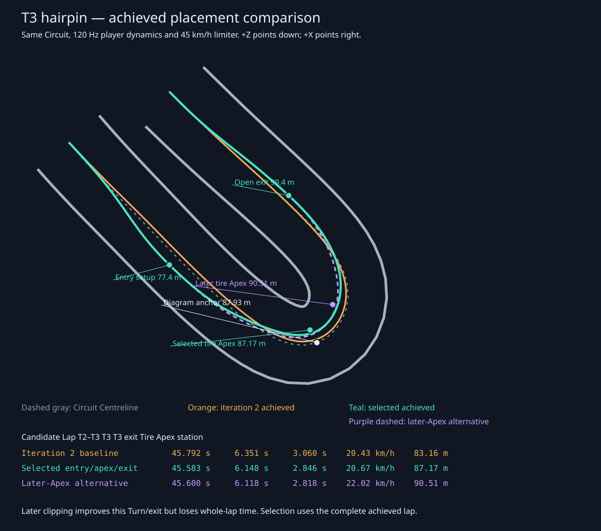

# Iteration 3: executable T3 hairpin

Ticket #27 delivers the representative T3 Left hairpin through the existing Reference Lap and public SimulationSession, before ticket #28 extends placement choices across the Circuit. It changes neither Circuit geometry, Kart handling, nor the 45 km/h limiter.

The gray dashed line is the Circuit Centreline; orange is the independently re-executed iteration-2 winner; teal is the selected observed traversal; purple is a later-Apex alternative. Entry setup, diagram anchor, actual inside-tire Apex, and opening exit are annotated in shared Circuit stations. These are measured Kart positions, not unexecuted proposals. The tire targets sit inside the Kart's center trajectory, as expected.

| Achieved candidate | Full lap | T2–T3 | T3 | T3 exit speed | Actual tire Apex station |
| --- | ---: | ---: | ---: | ---: | ---: |
| Iteration 2 selected baseline | 45.791667 s | 6.351161 s | 3.059934 s | 20.425763 km/h | 83.157877 m |
| Selected entry/Apex/exit | 45.583333 s | 6.148327 s | 2.845922 s | 20.667313 km/h | 87.173504 m |
| Later-Apex alternative | 45.600000 s | 6.118005 s | 2.817650 s | 22.017587 km/h | 90.506368 m |

The selected traversal gains **0.208333 seconds (0.455%)** over iteration 2. Its actual clipping point moves 4.02 m later than the old traversal's nearest inside-Barrier pass, although it remains 0.76 m earlier than the diagram anchor. The later alternative genuinely clips later (2.57 m after that anchor) and exits 1.35 km/h faster. Its T3 and T2–T3 times improve, but it loses **0.016667 s over the whole lap**, including the downstream transition. We retain the faster complete lap rather than forcing a textbook Late Apex everywhere. These are bounded candidates, not proof of a global optimum.

## Bounded proposal and validation

The proposal family now has separate entry, movable Apex, and exit control stations, joined with smooth quintic offset interpolation in Circuit-progress coordinates. Entry width, Apex width, and exit width can be set independently, enabling the connected-Turn extension. This slice compares three corridor-width uses (45%, 70%, 90% of the allowed center offset) with three requested Apex shifts (-1.5, +1, +3 m). The proposal leaves 0.95 m from Kart center to the local Barrier centerline before execution; physical clearance is subsequently judged with the existing swept whole-Kart solver.

Six of nine proposals complete cleanly; three exceed the existing steering range and are rejected before publishing a time. The feasible observed clipping stations span **85.31–90.51 m**. All selected commands, speeds, complete Kart states, poses, and times come from the player's ordinary 120 Hz dynamics after warmup. The original centreline and iteration-2 candidate evidence remains intact for the full-Circuit comparison.

The selected hairpin's minimum sampled whole-Kart envelope distance to a physical Barrier surface is **1.180 m**, measured across the full entry/exit region; its inside tire is 1.533 m from the inside Barrier centerline at the Apex. These distinct measurements must not be confused with tire-to-surface clearance. The swept player solver reports no Barrier contact during the full traversal or twelve repeated control tapes. The retained lap's end/start mismatch is 0.0050 m position, 0.000169 rad heading, 0.00234 m/s speed, and 0.000153 rad/s yaw rate. The later alternative closes within 0.000042 m.

## One actual training target

A Turn's target is now the observed inside front tire's nearest approach to the inside physical Barrier segments within that Turn window, rather than the diagram's fixed Apex station or the lowest-speed frame. This definition applies to all existing reference consumers. The ordinary Racing Line, Reference Ghost Kart, timing lookup, Flying Entries, all sixteen Corner Drills, Apex Proximity, and coaching use the selected Reference Lap. The new T3 public-session test verifies outside entry, inside clipping, an opening exit, fixed displayed positions, matching Ghost poses, a clean reference-matched Execution Card, and zero Apex Proximity.

The previous drill miss-driver intentionally displaced only the old fixed Apex station. It now displaces the full Turn window, so its user-input variation still misses the target when the actual Apex moves. The drill regression asserts the target is an achieved inside-tire position and has minimum physical inside-Barrier distance among the Turn's recorded frames.

## Reproduction and current checks

Run `npm run evidence:hairpin` to independently reconstruct the old winner from its retained candidate lineage, execute the later alternative, repeat the selected tape through SimulationSession, and regenerate the SVG and machine-readable [comparison evidence](iteration-3-hairpin-evidence.json). All measurements above use the unchanged handling on the ticket-27 branch.

After merging integration commit `b84a2c5`, **all 70 tests pass**, and the production build (including type checking) succeeds. The focused hairpin tests, all sixteen reference-backed drill replays, line/Ghost/timing checks, reverse regressions, and twelve-lap repetition are green. The regenerated public-session evidence records **twelve completed clean laps**, `Finished`, and zero Barrier contacts, without state resets. The new tape exposed an exact floating-point lap-boundary comparison; ticket #24's shared Session timing guard now uses a 1e-6 m numerical tolerance. No contact checks were relaxed.

The generated SVG was rendered locally with Quick Look and inspected for readable placement and labels. The browser file-URL route was unavailable under its URL policy; no browser-policy workaround was used. The artifact and public-session geometry checks provide review evidence here; final in-motion camera/line acceptance belongs to the integrated iteration verification.
