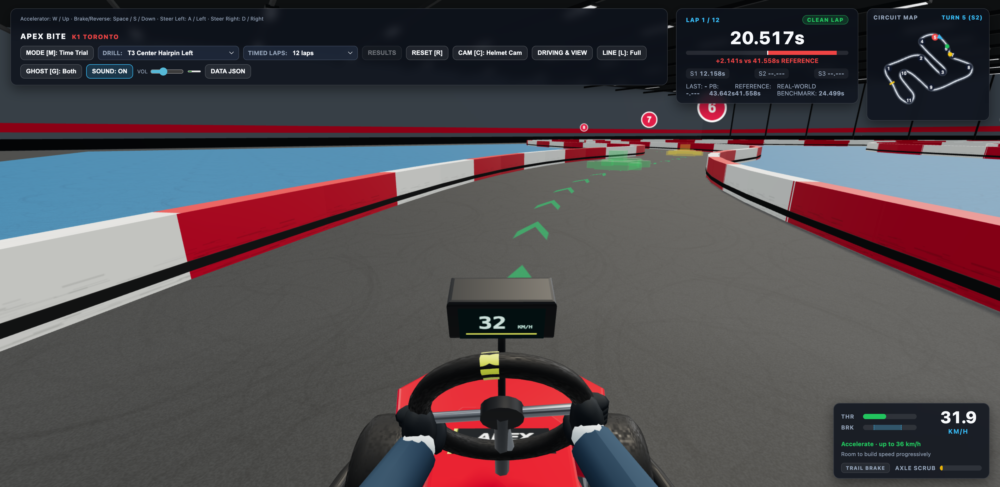
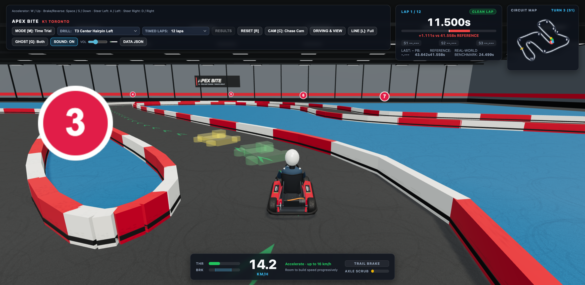
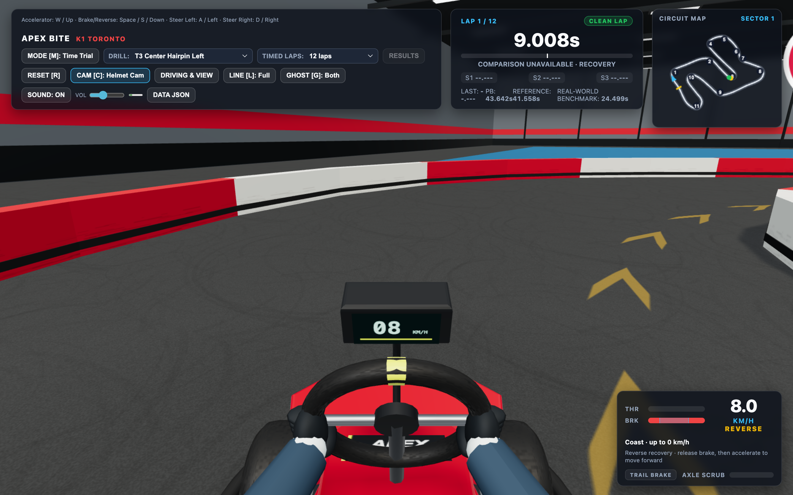

# Iteration 3 implementation and integrated verification

Iteration 3 delivers progressive Brake/Reverse and keyboard remapping, a fitted seated driver in both views, a corner-aware executable Racing Line with live translucent cues, and a repair for Ghost Kart geometry obscuring the player. **The normal game still defaults to twelve laps. The final real-time browser acceptance sample uses four laps, as explicitly requested.**

## Delivered behavior and visuals

Space now provides progressive Brake/Reverse, with S/Down aliases and release/repress engagement from standstill; reverse is capped at 8 km/h. Four driving keys can be remapped with conflicts, active hints and restore defaults. Ordered net progress protects lap timing, while reverse poses remain intact in Ghost tapes. See [recovery evidence](iteration-3-recovery.md), [controls behavior](iteration-3-controls.md), and the [final 31-check production browser result](iteration-3-controls-final.json).

The authored seated driver, 270 mm wheel and steering-linked hands fit both cameras. [Asset inspection, licenses and proportions](iteration-3-driver.md) explain why no external character geometry was adopted. Integrated review found the centred HUD obscuring Helmet Cam forearms; Helmet telemetry now occupies a compact 300 px lower-right layout. All telemetry remains, and Chase retains its centred cluster. [Actual browser bounds and reverse/short-view checks](iteration-3-hud-layout.json) verify the repair.

The executable fixed Racing Line achieves **41.558333 s**, **4.291667 s / 9.36%** faster than the preserved iteration-2 proposal under the same protocol, with unchanged forward dynamics and Circuit. The [geometry report](iteration-3-reference-line.md) and [annotated full-Circuit comparison](iteration-3-reference-line.svg) document actual Apex placement, linked-Turn compromises and the bounded offline search. This is the fastest validated candidate found, not a proven global optimum. [Live translucent guidance evidence](iteration-3-guidance.md) covers color, opacity and recovery cues.

Each Ghost is independently suppressed within 2.2 m and fades to its existing opacity by 3.5 m; replay/timing data remain unchanged. [Sixteen actual-render cases and before/after pixels](iteration-3-ghost-overlap.md) verify overlap, independent Both behavior, reverse passes and stable paused fades.

## Final production performance: four browser laps

[Raw metrics](iteration-3-performance-2026-10-21.json) were collected on 2026-10-21 with headed Chrome **155.0.8059.85**, ANGLE Metal / **Apple M5 Pro**, Mac17,9, 48 GB memory, 16 GPU cores, macOS 27.0.1 (26A434). Viewport: **1920×936 CSS**, DPR **2**, Balanced effective DPR **1.25**, drawing buffer **2400×1170**. Production renderer, HUD, Full Racing Line and gesture-enabled audio ran throughout. No competing GPU tests ran.

Cold Session/reference construction took **59.0 ms**; all-sixteen-drill/record preflight **332.7 ms**; renderer construction **64.1 ms**; first renderer/HUD CPU work **72.6 ms**. Navigation to the first rendered frame was **578.9 ms**. This measures runtime winner execution, not the offline candidate search.

The genuine four-lap session finished in **166.2368 s**, with four Clean Laps, measured Sector splits, zero Barrier contacts, zero dropped wall time and zero page errors. Restart, frozen results, settings/record retention, legacy separation and explicit unlimited practice passed. A fresh normal Session was separately asserted to retain its twelve-lap default.

| Sample | Frames | Mean interval | Average FPS | p95 | p99 | Maximum |
| --- | ---: | ---: | ---: | ---: | ---: | ---: |
| Lap 2, Chase | 4,987 | 8.333 ms | 120.00 | 9.0 ms | 9.3 ms | 9.4 ms |
| Lap 3, Helmet | 4,987 | 8.334 ms | 120.00 | 9.2 ms | 9.3 ms | 9.4 ms |
| Lap 4, Chase | 4,987 | 8.333 ms | 120.00 | 9.2 ms | 9.3 ms | 9.4 ms |

After warmup, no interval exceeded 16.7 ms. **Warmup did contain one 91.3 ms interval**; it is retained in the raw data. From warmed lap 2 through lap 4, allocated geometry/texture/program counts stayed at **91/22/16**. Draw calls varied with camera/frustum; the skid pool stayed bounded at 320 with zero active marks during this clean tape.

Both Ghost modes were selected, but exact player/reference/PB playback causes near-player Ghost geometry to be suppressed. **These four laps are not claimed as continuous two-visible-Ghost load.** To measure actual Ghost drawing, a separate ordinary public-input driver followed at 90% reference speed against an earned slower clean PB (43.641667 s):

| Separated Ghost sample | Frames after 4 s warmup | Average FPS | p95 | p99 | Maximum | Off → Both draws at start |
| --- | ---: | ---: | ---: | ---: | ---: | ---: |
| Chase | 600 | 119.89 | 9.8 ms | 10.2 ms | 16.7 ms | 63 → 77 |
| Helmet | 600 | 119.49 | 8.8 ms | 9.3 ms | 16.7 ms | 46 → 60 |

At unchanged snapshots, Reference-only and PB-only each added seven actual draws in both views. Public pose gaps and [raw short-sample results](iteration-3-integration-browser.json) demonstrate real separated geometry rather than counting selected-but-hidden meshes. Both short samples had no contacts, page errors, or intervals above 25 ms; audio output was active.

## Functional coverage, reproduction, and limits

All **78 public-Session tests**, type checking and the normal production build pass. Existing inexpensive deterministic tests still cover twelve clean tape laps, normal twelve-lap lifecycle and unlimited continuation; the real-time browser sample is four laps. All sixteen browser-preflight drills matched their selected Reference Lap, actual Apex targets, speed/timing/coaching and ordinary monotonic Ghost clocks. Additional browser checks cover remapping/focus/defaults, real reverse feedback, FOV endpoints, full steering in both directions, representative T3 and T6–T7–T8 execution cards, and actual normal-app Data import/views. The Ghost rendering regression adds sixteen actual pixel/mode cases. See [reproduction commands and QA harness](iteration-3-integration-qa.md).

Independent review identified and resolved one additional edge: a clean PB tape containing backward progress has no unique drill entry time. The Personal Best Ghost is now suppressed for that unavailable Corner Drill comparison, including in Both mode; the Reference Ghost and valid full-lap PB time playback remain available. The existing public Session recovery test failed before the fix and now verifies T3, advancing Reference playback, return to Time Trial, unchanged Kart/drill state on Ghost mode changes, and byte-for-byte record retention. All **78 tests**, type checking and the production build pass after the fix. [The review resolution](iteration-3-code-review.md) records zero remaining findings. The full-lap render path is unchanged, so the four-lap and renderer measurements remain applicable without another GPU run.

These are local M5 Pro results, not a broad laptop guarantee or isolated GPU timings. The current 120 Hz rAF cadence does not establish a twofold GPU speedup over an earlier 60 Hz run. Browser accumulation beyond four laps remains unmeasured, per the approved scope; saturated skid-mark load, a physically connected gamepad, human acoustic quality and formal human usability remain unverified. Earlier interrupted or superseded twelve-lap attempts are excluded from final performance evidence. Vite retains its existing large-bundle advisory. No production deployment was performed.
