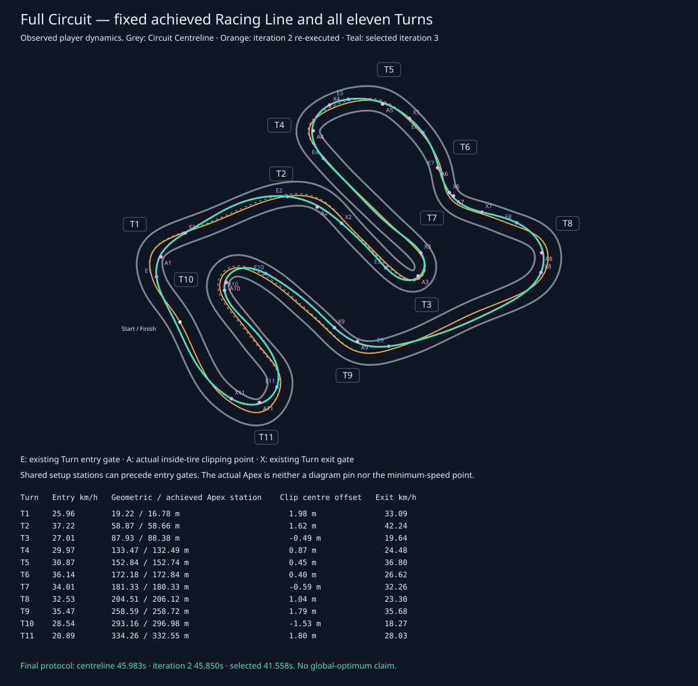
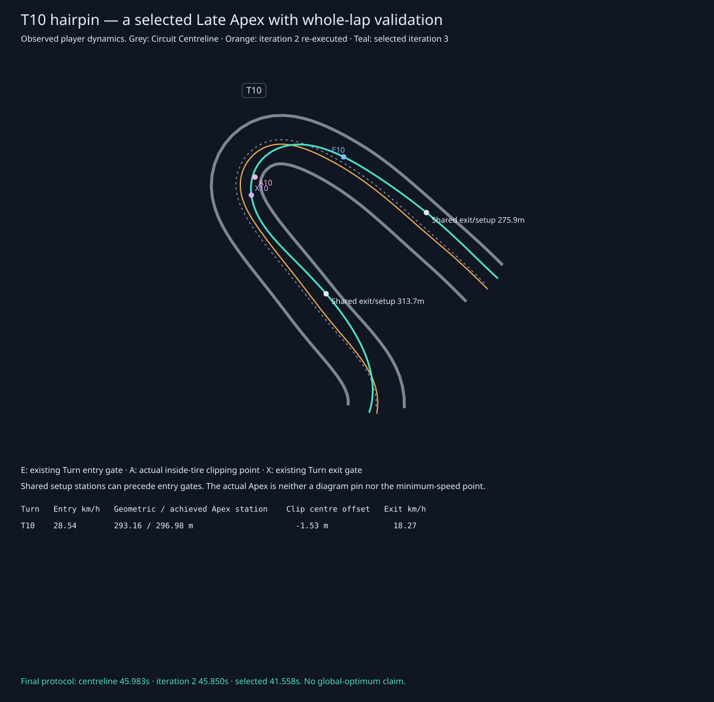
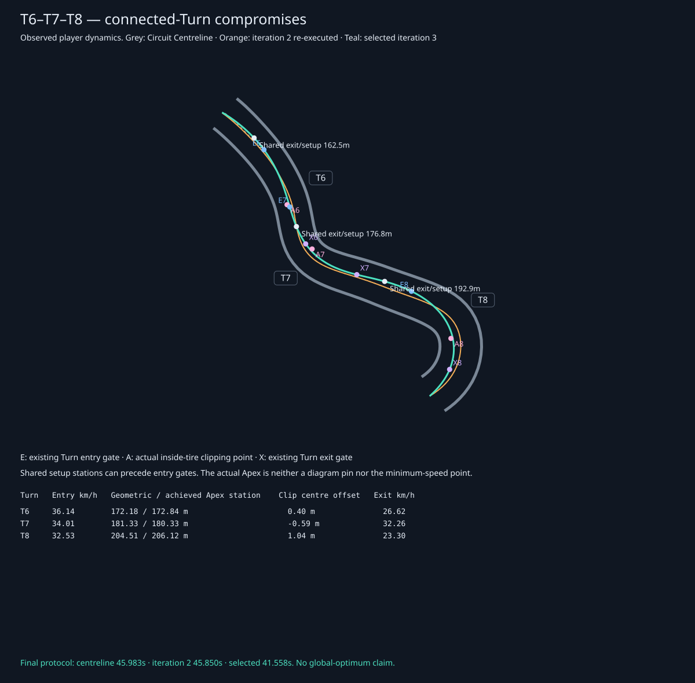

# Iteration 3: a Circuit-wide executable Racing Line

Ticket #28 replaces the near-centre reference with a fixed, achieved path that uses deliberate corner placement, shared exit/entry setups, and context-dependent Apex timing. It preserves the Circuit, the Kart's player physics, the 45 km/h forward limiter, and the separately labelled 24.499-second Real-World Benchmark.

The overlay marks each existing Turn entry gate (E), the selected inside-front-tire clipping point (A), and the existing exit gate (X). Shared setup stations can precede these narrow Turn windows: an E marker is not a mandate to begin turning there. Gray is the Circuit Centreline, orange is the preserved iteration-2 proposal re-executed under the final traversal protocol, and teal is the observed iteration-3 Kart path.

## Comparable measured improvement

Every row below uses identical current player dynamics, physical path-distance lookahead, two warmup laps, retained 120 Hz commands/states, and swept whole-Kart Barrier validation. We publish achieved traversal geometry, never the requested proposal alone.

| Candidate | Achieved full lap | Minimum sampled whole-Kart surface clearance |
| --- | ---: | ---: |
| Conservative Circuit Centreline | 45.983333 s | 1.693 m |
| Preserved iteration-2 winner, final protocol | 45.850000 s | 1.391 m |
| Shared entry/Apex/exit placements before smoothing | 44.666667 s | 0.434 m |
| Selected smoothed shared placements | **41.558333 s** | **0.289 m** |

The selected lap gains **4.291667 s (9.36%)** over the comparable iteration-2 baseline and **4.425 s (9.62%)** over the centreline. Iteration 2's historical **45.791667 s** used the previous lookahead protocol; it remains recorded as history, rather than being substituted for the final-protocol baseline.

| Corner Complex | Iteration 2 | Selected | Entry speed before → after | Exit speed before → after |
| --- | ---: | ---: | ---: | ---: |
| T1–T3 | 10.987 s | 9.689 s | 26.89 → 25.96 km/h | 20.43 → 19.62 km/h |
| T2–T3 | 6.370 s | 5.678 s | 33.41 → 37.20 km/h | 20.43 → 19.62 km/h |
| T4–T5 | 4.950 s | 4.369 s | 27.83 → 29.98 km/h | 33.58 → 36.81 km/h |
| T6–T7–T8 | 6.431 s | 5.595 s | 38.74 → 36.16 km/h | 23.31 → 23.30 km/h |
| T9–T10–T11 | 12.576 s | 11.157 s | 32.98 → 35.44 km/h | 29.16 → 28.05 km/h |

The Complex windows overlap, so their gains must not be summed as independent lap savings. Faster segment times do not imply faster entry or exit everywhere. In particular, the selected Esses approach is slower and its exit speed is almost unchanged, while the complete Complex improves. These are observed comparisons, not an invented causal explanation.

## Placement, compromises, and Late Apexes

T10 supplies a clear selected Late Apex: the actual tire target moves to **296.983 m**, **3.825 m beyond** the diagram's 293.158 m anchor. Its Kart centre reaches approximately **1.53 m inside** the Circuit Centreline at the clipping point. The selected reference then prepares the following Carousel through a shared exit/setup station. The whole-lap objective admits that compromise; it does not require a Late Apex in every Turn or promise a faster exit at every gate.

The alternating Esses share a single position between adjacent Turns. One Turn's exit cannot request a position incompatible with the next Turn's entry. T6 clips slightly later than its anchor; T7 clips earlier; T8 clips later. These tight Turns use less width than T1, T2, T9, T10, and T11, preserving steering feasibility and connected-Turn speed. The geometry stays fixed during driving.

The [T3 detail](iteration-3-reference-hairpin.svg) shows another compromise. Its selected actual Apex is 88.376 m versus the 87.932 m anchor, with a modest outside setup and approximately 0.49 m inside centre placement at clipping. It remains more conservative than T10; we do not disguise that limit or force the earlier ticket-27 isolated hairpin choice into a slower full-Circuit lap.

The achieved Kart-centre ranges reach roughly **+2.00 m in T1, +1.63 m in T2, −1.56 m in T10, and +1.88 m in T11**. T1's outside-to-inside approach spans over two Kart widths. The complete per-Turn entry/Apex/exit stations, offsets, speeds, corridor widths, and feasible-proposal counts are in the [machine-readable evidence](iteration-3-reference-line-evidence.json).

## Bounded construction and runtime cost

The original centreline, prior pinned-Apex rejection, iteration-2 whole-Complex candidates, and ticket-27 local hairpin alternatives remain in the comparison set. The new periodic proposal family exposes each Turn's entry/setup width, inside width, and movable clipping station. Adjacent Turns share setup stations, joined with monotone cubic interpolation that cannot overshoot its lateral node bounds. A single bounded coordinate pass tries narrow, medium, wide, and opposite-side setup compromises with geometric and later Apex choices across all eleven Turns.

Two additional bounded curvature-smoothing alternatives can move the chosen placement by at most 0.4 m or 0.8 m. Their curvature proxy proposes smoother geometry; **achieved full-lap time** decides whether to keep it. The proxy is not a replacement lap-time objective. This is one Circuit-specific, offline candidate construction inside the existing Reference Lap system, with no optimizer service, AI training, or global-optimality claim.

The final search evaluates **165 candidates: 149 feasible, 16 rejected**. Requested curvature violations and swept whole-Kart contacts are explicit rejection evidence. The new family reserves **0.65 m from Kart centre to Barrier centreline** at proposal nodes: 0.45 m half-width, 0.12 m Barrier half-thickness, and an initial 0.08 m margin. The earlier 0.95 m reserve is retained only for reproducing old local proposals. All actual retained candidates must still pass swept envelope checks. The selected minimum sampled physical surface clearance is 0.289 m; sampled clearance and continuous swept contact validation are separate measurements.

Cold search measured **8.71–8.81 seconds** on an Apple M5 Pro, which justified precomputation. `npm run reference:generate` runs the bounded search offline and writes a compact typed recipe with proposed positions, comparison evidence, and a content stamp. Runtime executes **only the winner** against the real player solver, verifies its achieved time and closure, publishes those observed frames, and freezes/caches the reference. No candidate search runs during live driving.

The CLI evidence run measured **73–77 ms** for a cold public Session, **4.8–5.2 ms** for a cached Session plus initial snapshot, and approximately **0.00006 ms** per cached Reference Lap lookup. These are local Node CPU measurements, not browser frame-rate claims. Integrated browser startup and frame timing are measured separately. The stamp quantizes geometry/parameters to micrometre precision, and runtime allows at most one 120 Hz tick of cross-engine crossing variation while retaining its own achieved winner time and Complex evidence.

## Shared coordinates and training consistency

Circuit stations remain the common coordinate for timing, Ghost lookup, drills, and coaching. Physical path arc length is now a separate cached metric. Both reference steering lookahead and braking anticipation convert physical distance to/from station coordinates, so a wider or shorter path does not silently change the meaning of a metre. Display resampling also accounts for the small Circuit station already covered at the retained lap's initial crossing, removing its previous spatial offset.

All sixteen Turn/Complex drills replay from the selected Flying Entry, produce zero reference delta and zero Apex Proximity, and retain matching Ghost motion, speeds, timing, and measured coaching. Twelve retained control tapes complete **twelve Clean Laps with zero Barrier contacts**, without resets. The selected lap closes within **0.0000464 m position, 0.000000418 rad heading, 0.000000373 m/s speed, and 0.000000585 rad/s yaw rate**. Ordinary Session replay tests compare the complete Kart states with the retained tape.

Changing the reference does not invalidate compatible full-lap Personal Bests, Sector splits, or Ghost Karts: player handling and Circuit geometry remain unchanged. Corner Drill PBs are different: the achieved Flying Entry pose/speed and sampled exit gate have changed. Drill records now carry a physical entry/gate fingerprint, quantized to 0.1 mm, 0.1 mm/s, and 0.0001 rad to tolerate harmless engine differences. Labels and reference benchmark times do not affect compatibility. Unversioned or incompatible drill times are retained as archived drill achievements in JSON and the Data dialog, excluded from active comparisons; matching-reference imports remain active. Existing handling/Circuit legacy archives remain intact.

## Verification and reproduction

- `npm run reference:generate`: reproducible bounded search and recipe generation.
- `npm run evidence:reference` (or `evidence:hairpin`): independently reconstruct/re-execute the preserved baseline, measure all eleven Turns/five Complexes, replay all sixteen drills and twelve clean laps, and regenerate the JSON plus four SVG overlays.
- Public Session tests cover candidate coverage, a visibly noncentral opening Turn, observed geometry at common Circuit stations, complete tape replay, Ghost/timing agreement, movable tire targets, portable archive compatibility, and lap/sector integrity.
- Focused geometry/reference/drill/record suites pass (25 tests), and production build/type checking pass. Final integrated suites are recorded after merging the latest integration branch. The SVGs are rendered locally and visually inspected; in-motion camera and guidance acceptance remains part of the integrated verification.

Existing test scenarios needed explicit updates because the actual reference changed: the Flying Start is now **38.3535 km/h**, taken from the selected traversal; the former +0.9 m T2 miss now reaches the inside Barrier, so the clean miss uses an outward −0.9 m variation. The old fixed circle input sequence could no longer enter its orbit from the new Flying Start without hitting a Barrier; repeated deliberate backward/forward Start/Finish recrossings now exercise the same no-false-lap/timer invariant through reachable public controls. Grip telemetry includes up to 0.22 m/s² of rolling drag outside the unchanged 10.5 m/s² tire ellipse, so its net-acceleration test uses the physical 10.72 bound. No Kart physics, grip, dimensions, or speed constraints were changed to satisfy tests or manufacture lap-time gains.
