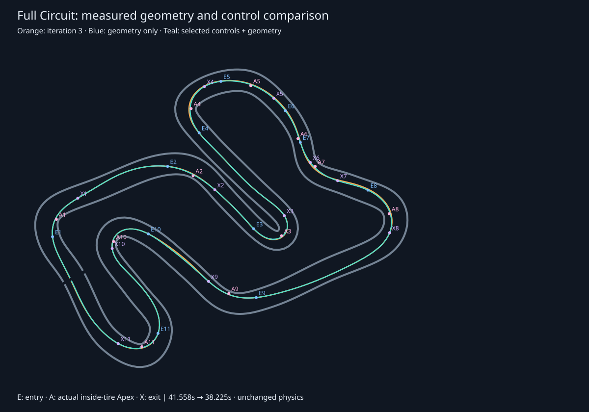
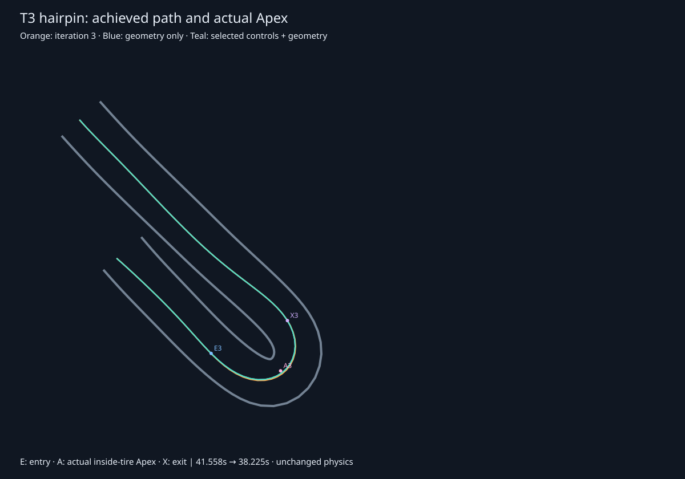
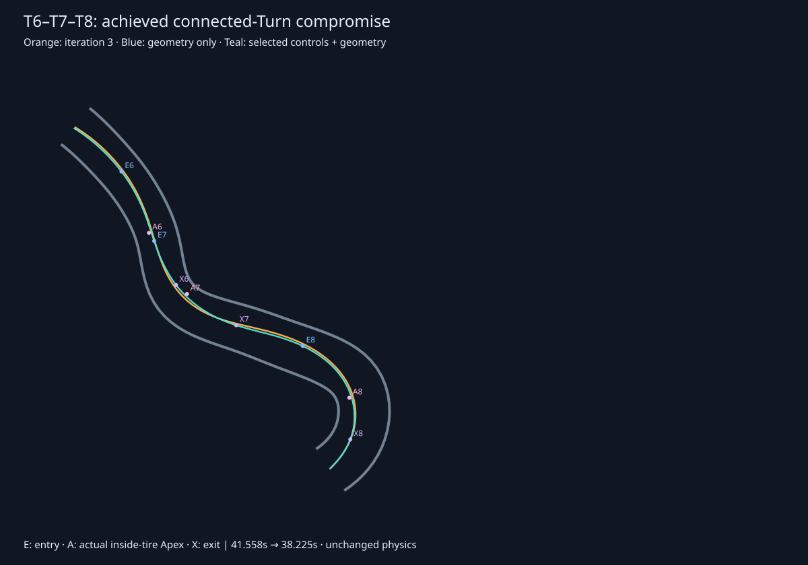

# Iteration 4: bounded speed and control experiment

Ticket #41 selects an achieved **38.225000 s** lap, **3.333333 s (8.02%)** faster than the preserved iteration-3 baseline, under unchanged player physics. The selected input tape repeats twelve laps without Barrier contact or resets. This is a candidate for #42 adoption; the live Reference Lap is still unchanged.

## What changed and what stayed comparable

The reference generator now accepts four optional driver settings: target cornering acceleration, top-speed fraction, braking scale, and lookahead scale. Omitting them preserves the old controller exactly: 5.2 m/s², 0.96, 1, and 1. The default still reproduces the frozen baseline at **41.558333 s** and the #40 geometry candidate at **41.316667 s**, with the existing signature `93d2c9fd`.

These settings tune the automated reference driver, not tire grip, Kart dimensions, motor behavior, steering physics, player controls, or the Circuit. Braking scale multiplies the existing speed-profile braking bound and braking anticipation/horizon consistently. Lookahead scale multiplies the existing distance-plus-speed tracking lookahead. The selected settings are **6.4 m/s² cornering target, 0.96 top-speed fraction, 1.1 braking scale, and 1.15 lookahead scale**. Selection does not raise the straight-line speed target.

The original content signature still identifies the unchanged default driver and player dynamics. A future adopted non-default recipe must explicitly retain its driver settings and validate them as part of that recipe; the default signature by itself does not identify a tuned configuration. The candidate artifact includes settings, proposal coordinates, and a full-content SHA-256 for this purpose. It must not be adopted by copying coordinates alone.

## Fixed comparison and acceptance

The [protocol](iteration-4-controls/control-protocol.json) was written before the search. It pins the exact #40 geometry bundle by SHA-256 and reuses its baseline, candidate geometry, measurements, and robustness thresholds. The finite grid is four cornering targets (5.2, 5.6, 6.0, 6.4), three braking scales (1, 0.9, 1.1), three lookahead scales (1, 1.15, 1.3), and two top-speed fractions (0.96, 1). All 72 combinations run on both baseline and improved geometry: **144 trials**, plus two default-controller reproduction checks. No adaptive search or scope expansion follows the grid.

Every candidate executes through the existing player solver after two warmup laps. Contact, reversed progress, or unsettled lap closure rejects execution. The unchanged #40 robustness limits are minimum sampled whole-Kart clearance **0.28 m**, p95 front-wheel steering rate **0.28 rad/s**, peak rate **1.34 rad/s**, and total angle variation **4.2 rad**. Every robust candidate that would improve its geometry's incumbent must additionally pass twelve uninterrupted input-tape replay laps before selection. No gate was weakened to admit a faster result.

The sampled clearance metric uses the existing rectangle-to-Barrier sample-chord calculation at 120 Hz, minus wall half-thickness; it is separate from the solver's swept collision checks against overlapping physical chords. It is not a proof of minimum continuous surface clearance.

All 144 trials executed; **63 failed robustness gates**. The [full evidence](iteration-4-controls/control-evidence.json) retains their measured times and rejection reasons. For example, raising only the baseline's top-speed fraction to 1 gives a faster 41.491667-second lap but a 1.373767 rad/s steering peak, exceeding the fixed 1.34 limit; it is rejected. Raw fastest time therefore does not override training robustness.

## Separate geometry and controller effects

| Comparison | Achieved lap, s | Gain against iteration 3, s |
| --- | ---: | ---: |
| Frozen iteration 3 | 41.558333 | — |
| Geometry only (#40), default controller | 41.316667 | 0.241667 |
| Best controls on original geometry | 38.425000 | 3.133333 |
| Best controls on improved geometry | **38.225000** | **3.333333** |

The improved geometry adds **0.200000 s** against the best controller result on original geometry. Controller changes add **3.091667 s** against geometry-only. These conditional differences are not additive independent causes; path and controller interact. Most of the measured gain comes from changing the reference driver's choices, not moving the visible line farther from the centre.

The selected candidate's sampled clearance is **0.289131 m**, p95 steering rate **0.264055 rad/s**, peak rate **0.990243 rad/s**, and total variation **3.554148 rad**. Its closure position mismatch is 0.000036 m. Twelve uninterrupted tape laps cover 12.000001189 Circuit lengths with zero contacts.

| Corner Complex | Iteration 3, s | Selected candidate, s | Gain, s |
| --- | ---: | ---: | ---: |
| T1-T3 | 9.688807 | 8.915921 | +0.772886 |
| T2-T3 | 5.677879 | 5.152783 | +0.525096 |
| T4-T5 | 4.369332 | 3.957138 | +0.412194 |
| T6-T7-T8 | 5.595143 | 4.894807 | +0.700337 |
| T9-T10-T11 | 11.156818 | 10.217759 | +0.939059 |

Complex windows overlap and must not be summed as independent lap savings.

## Placement through all Turns

The drawn paths and clipping points come from achieved traversal, not proposal coordinates. The table compares original and selected observed speeds and Apex stations; full physical entry/Apex/exit coordinates are retained in the evidence.

| Turn | Entry speed, km/h | Actual Apex station, m | Exit speed, km/h |
| --- | ---: | ---: | ---: |
| T1 | 25.96 → 28.80 | 16.784 → 16.748 | 33.09 → 35.15 |
| T2 | 37.22 → 39.72 | 58.665 → 58.622 | 42.24 → 43.37 |
| T3 | 27.01 → 29.22 | 88.376 → 88.307 | 19.64 → 21.44 |
| T4 | 29.97 → 32.61 | 132.490 → 132.428 | 24.48 → 26.33 |
| T5 | 30.87 → 31.99 | 152.744 → 152.779 | 36.80 → 41.38 |
| T6 | 36.14 → 41.24 | 172.841 → 172.138 | 26.62 → 31.71 |
| T7 | 34.01 → 38.34 | 180.330 → 180.962 | 32.26 → 36.53 |
| T8 | 32.53 → 35.06 | 206.122 → 205.397 | 23.30 → 25.07 |
| T9 | 35.47 → 38.93 | 258.722 → 258.541 | 35.68 → 38.49 |
| T10 | 28.54 → 31.06 | 296.983 → 296.970 | 18.27 → 20.19 |
| T11 | 20.89 → 22.80 | 332.551 → 333.079 | 28.03 → 30.38 |

T1 retains an early clipping point before its diagram anchor, setting up T2; T2's placement remains near its geometric Apex while carrying more speed into the T3 approach. T3 still clips slightly after its anchor (88.307 m versus 87.932 m), with a measured 17.34 km/h Apex speed and 21.44 km/h exit: the experiment does not impose a late exit-biased shape everywhere. T4 clips early within the shared T4–T5 sequence, while T5 stays near its anchor and exits faster into the Esses.

T6 and T7 clip near/before their anchors, and T8 later than its anchor; their connected sequence improves from 5.595143 to 4.894807 s. The geometry-only result already shifted the T6/T7 placement, while the control change raises the achieved speeds. T9 remains near its anchor, T10 retains its deliberate late clipping point (296.970 m versus 293.158 m), and T11 clips early before the Start/Finish approach. These are measured compromises of the retained path; the comparison does not establish a separate causal optimum for each Turn.

## Reproduction and adoption handoff

Run `npm run reference:generate -- --control-experiment`. Optional `--budget <1..144>`, `--geometry <bundle-directory>`, and `--output <directory>` allow bounded review runs. The input bundle hash must match its retained checksum. Full results are in the [evidence](iteration-4-controls/control-evidence.json); the [adoption candidate](iteration-4-controls/control-candidate.json) retains the exact proposal **including driver settings**, initial state, analog input tape, achieved points, closure, protocol, and metrics, accompanied by its [SHA-256](iteration-4-controls/control-candidate.sha256).

#42 must integrate and revalidate the chosen recipe with its settings, then verify public Session replay, line/Ghost/timing consistency, all sixteen drills, braking guidance, and record compatibility. This ticket deliberately does not alter the production recipe or those training targets.

The grid is exhausted and the selected cornering target lies at its upper bound. That is evidence of a bounded search, not justification to expand it automatically or claim a global optimum. Geometry-locality limitations from #40 still apply. The empirical robustness gates constrain this candidate family; they do not establish a real-world K1 optimal lap or a guarantee of human repeatability.

## Verification

The CLI regression failed before implementation because the requested report did not exist. It now exercises both geometries, exact frozen default times, a faster-but-abrupt rejected control choice, bounded output, repeated replay, and byte-for-byte preservation of the production recipe. Existing public Session Reference Lap tests continue to establish unchanged default playback. The achieved-path SVGs were rendered in headless Chrome and visually inspected at 1200×840.

All eleven focused tests pass, along with type checking and the production build. The build retains its existing bundle-size warning. Candidate checksum, driver settings, and control-tape length were independently checked.
