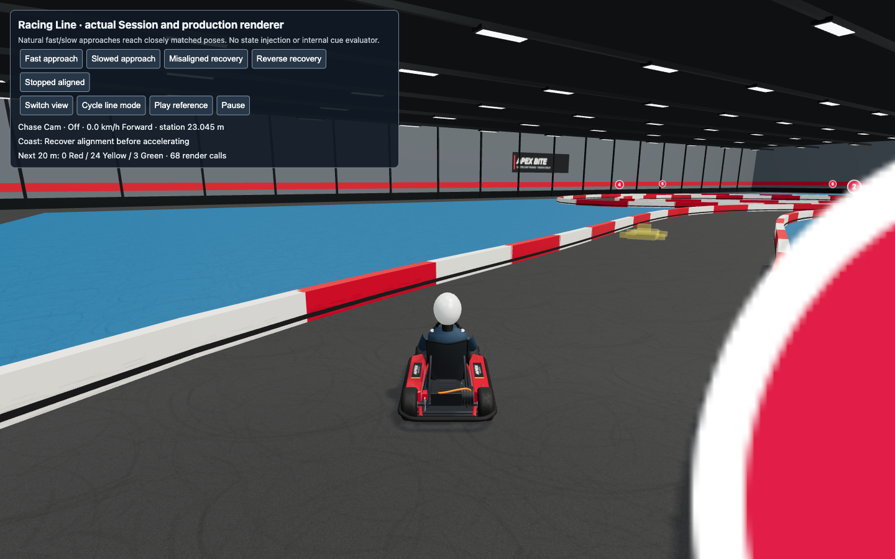
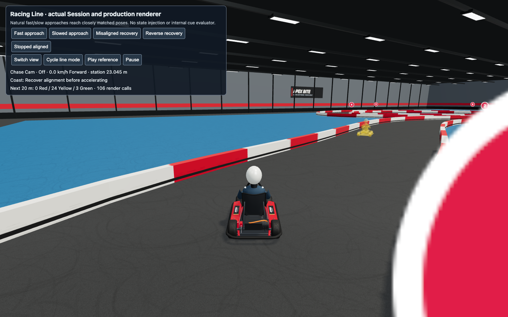
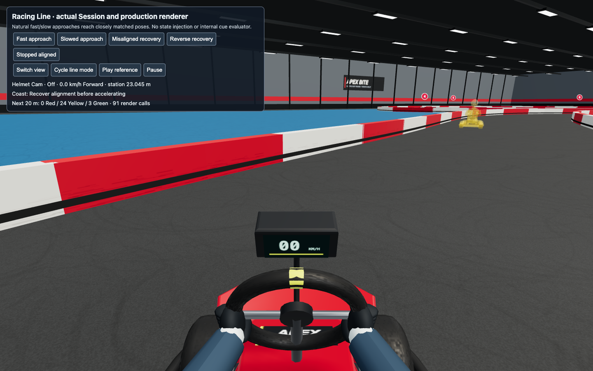

# Iteration 4: current-model Ghost Karts

Ticket #35 replaces the obsolete three-box/four-cylinder Ghost Kart with the same Kart-and-driver construction used for the player. Each instance owns its materials; ghost-only tint and fading never change the player or the other ghost. Ghosts do not cast physical shadows. The existing independent 2.2 m suppression and 1.3 m restoration band are preserved.

The production change is a narrow renderer adapter around the existing Kart rig. It supplies replay position, heading, and speed and keeps the ghost's head visible even when the player uses Helmet Cam. This slice retains neutral steering because current recordings contain no steering; ticket #36 supplies recorded steering and the older-record fallback. No simulation, recording schema, replay timing, or training behavior changes here.

## Observable regression and verification

The new `ghost-model-check.mjs` uses ordinary public Session scenarios and the production canvas. It compares ghost-on/off pixels at the projected seated driver's helmet region, checks that pixels outside the ghost's enclosing volume remain unchanged, and verifies snapshots and exported records remain identical. It does not inspect the rig, material hierarchy, or mesh counts.

Before the repair, the first Chase Cam Reference Lap assertion fails: zero changed pixels in the driver region. After the repair, all four camera/ghost-type cases pass, with 188–495 changed driver-region pixels and zero changed pixels outside the ghost. [Red evidence](iteration-4-ghost-model-red.json) and [passing evidence](iteration-4-ghost-model-check.json) preserve those results. The numerical pixel counts are observations, not golden-image acceptance targets.

The existing ghost-overlap browser regression passes all 16 cases, including Reference Lap, Personal Best, Both, Off, coincidence, partial/side overlap, one ghost overlapping while another is separated, reverse, smooth separation, and stable repeated frames. See [overlap evidence](iteration-4-ghost-overlap-check.json).

All 78 behavior tests, type checking, and production build pass. The build retains the existing advisory about a large application chunk.

## Visible rendering cost

Chrome 155.0.8059.85, Balanced quality, 1440 × 900 CSS pixels, DPR 1, fixed public Session scenes, Racing Line hidden for the silhouette check:

| View | Ghost off | One separated current-model ghost | Increment |
| --- | ---: | ---: | ---: |
| Chase Cam render calls | 61 | 106 | 45 |
| Helmet Cam render calls | 46 | 91 | 45 |
| Rendered triangles, either view | baseline | baseline + 22,450 | 22,450 |

Both Reference Lap and Personal Best cases give the same increments. These are actual production-renderer counters while the ghost is visible, not a frame-rate claim. Full production frame-time acceptance with both ghosts belongs to the final integration ticket. The added geometry is the actual current Kart and driver, not a separately maintained approximation.

## Reproduction

Run the existing dev server and the browser launcher with `APEX_BITE_GHOST_URL` pointing to its racing-guidance harness. Set `APEX_BITE_PLAYWRIGHT_MODULE` to an installed Playwright module when it is not available through normal package resolution. `APEX_BITE_GHOST_EVIDENCE` controls evidence output. Run both `ghost-model-check.mjs` and the existing `ghost-overlap-check.mjs`; the new launcher's default server port is 5185. No browser dependency was added to the game.
