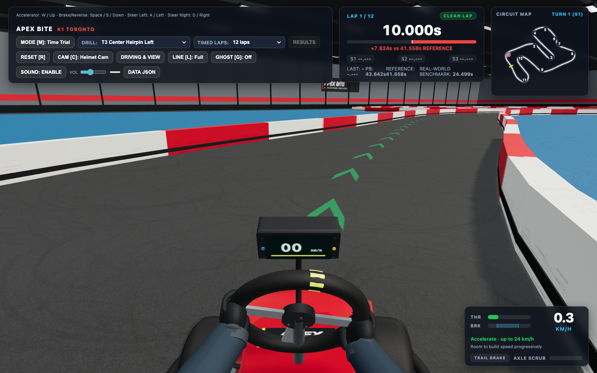
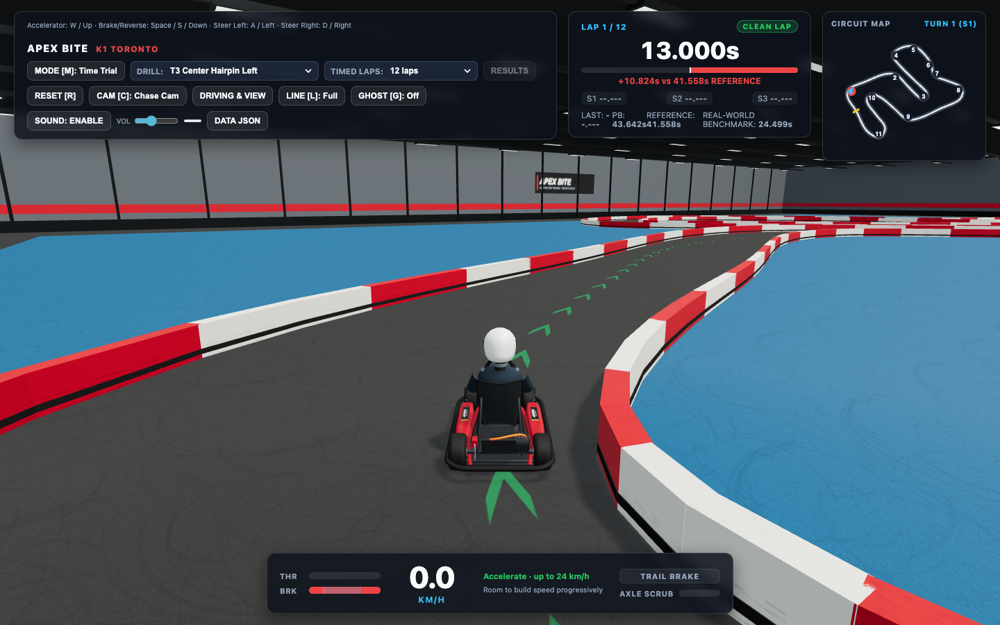
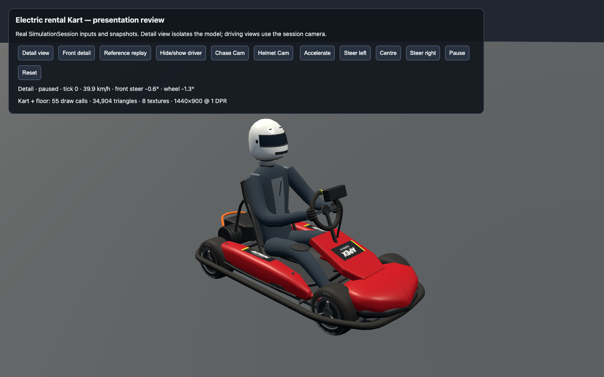

# Iteration 4: Kart and driver visual review

**Status: technical implementation prepared; user visual acceptance pending.** This is the concrete review packet for #38, before completing final visual integration. The user can accept the proposed appearance or identify specific remaining changes; automated checks do not decide whether the realism target is met.

## What changed

The helmet is now a continuous full-face shell with an integrated chin bar, wrapped visor and seal, inset chin intake, crown vents and side fasteners. The separate oval chin piece is gone. The fitted suit has a smoother torso and limbs, a narrower subdued front panel, fine original fabric bump detail, and modest sleeve gathering near the elbows and wrists. Gloves have smaller shaped palms, padded backs, cuffs and four curved fingers clasping the rim. The steering grips and small existing two-link arm solve remain in place.

This driver sits in the improved #37 Kart; both Ghost Kart types construct the same current model. Wheel dimensions, seating/shoulder attachment locations, eye position, camera settings, physical Kart dimensions and handling remain unchanged. The complete helmet/neck assembly remains hidden only for the player's Helmet Cam. Field of view and camera comfort settings remain available.

## Review the actual game views

These matched pairs use the production renderer and full game HUD through the existing public Session recovery harness. The old driver is the iteration-3 driver; the Kart is already the #37 version in both images so the driver difference can be judged directly. Matching public Kart states are identical in the [before](iteration-4-driver/before-hud.json) and [after](iteration-4-driver/after-hud.json) reports. The complete Kart's earlier before/after comparison is in [the #37 report](iteration-4-kart.md).

| View | Previous driver | Proposed driver |
| --- | --- | --- |
| Helmet Cam and game HUD |  |  |
| Chase Cam and game HUD |  |  |
| Matching front detail |  |  |

Steering motion with the game HUD: [previous](iteration-4-driver/before-hud-motion.webm) / [proposed](iteration-4-driver/after-hud-motion.webm). These videos exercise left, centre, right, return, Chase Cam and separated ghosts through ordinary public commands. Still samples show [left grip](iteration-4-driver/after-hud-helmet-left.png), [right grip](iteration-4-driver/after-hud-helmet-right.png), and [separated current-model ghosts with the HUD](iteration-4-driver/after-hud-ghost-chase.png). A [closer separated-ghost view](iteration-4-driver/after-ghost-chase.png) uses the same production renderer in the guidance harness.

Please judge the helmet/chin silhouette, seated body proportions, glove grip through steering, suit/material appearance, and whether Helmet Cam remains clear and comfortable. This packet does not replace the final integrated behavior and four-lap performance checks.

## Asset inspection and authorship

The actual free Kenney Car Kit character was re-inspected from the retained CC0 archive before choosing this implementation. Its `kart-oopi.glb` character is 818 triangles with position, normal, tangent and texture-coordinate attributes, a single shared palette material, and no skin, joint attributes, bones or animation clips. Its broad stylized geometry and lack of an articulated adult seated form would require rebuilding the body, helmet and grip. The archive's actual license and full five-Kart inspection are recorded in [#37's provenance section](iteration-4-kart.md); the earlier measured character dimensions and seated-fit review remain in [the iteration-3 report](iteration-3-driver.md).

No downloaded character, rig or texture was adopted. The existing fitted driver is refined with original geometry and a single 128×128 procedural fabric texture (64 KiB RGBA before mipmaps), using the existing Three.js dependency. Gated or unavailable candidate listings are not treated as verified usable assets. No animation framework, humanoid retargeting system, paid asset or new dependency is added.

## Technical evidence

The source driver grows from 5,860 to 13,572 triangles. The isolated detail view including Kart and floor changes from 54 calls / 27,192 triangles / 7 textures to 55 / 34,904 / 8. Helmet Cam changes from 39 / 19,988 / 7 to 39 / 25,188 / 8 because the head is culled. Static surfaces still batch by material, and sleeve positions are solved only when the steering angle changes. The new fabric texture is shared across the suit and glove-padding materials within each rig.

Short production-scene samples use installed Chrome, Balanced quality, 1440×900 CSS pixels, DPR 1, and Apple M5 Pro/ANGLE Metal. With a separated reference ghost visible, each view receives 60 warmup frames and 180 measured paused-scene intervals. Both old and proposed scenes measure about 16.67 ms mean / 16.7–16.8 ms p95. Chase Cam goes from 121 calls / 73,514 triangles to 123 / 88,938; Helmet Cam from 106 / 66,310 to 107 / 79,222. These local samples meet the existing 60 FPS target on this hardware; #43 will measure the integrated moving production experience. Raw [before](iteration-4-driver/before-scene.json) and [after](iteration-4-driver/after-scene.json) reports retain browser/GPU details and errors (none).

The known visual defects were retained as the before-review evidence, then checked in the proposed views. Existing behavior regressions remain the verification seam for controls, cameras, saved records and replay; no mesh-layout or ornamental-color unit tests were added to claim that realism is automatically proven. Before integrating the latest reference adoption, all 85 tests, type checking and production build pass; rendered checks pass six steering/return/reverse samples, two ghost-steering comparisons, four current-model ghost cases and sixteen overlap cases. Any final validation after merging the integration tip is recorded below.

After merging the adopted reference through `bae3dbb`, all **88 tests across 21 files**, type checking and the production build pass. Six rendered steering samples, two ghost-steering comparisons and four current-model ghost cases also pass. The faster reference exposed an old reverse-overlap fixture assumption: during the original stop, the ghost now travels 2.55 m away and no longer intersects the player's 2.2 m suppression region. The QA fixture retains its original public braking input, holds the stopped Kart until the reference naturally laps and approaches within 1.5 m, then releases/represses reverse. Its wait is bounded to one reference lap; it injects no pose or clock. All sixteen overlap cases now pass, with both reverse samples actually reversing at 1.394 m separation and zero changed pixels. This adapts the test setup without changing production fading or physics.

The review images and videos deliberately retain their original matching reference/session conditions for a fair art comparison. Final rendering regressions use the newly adopted reference; the overall integrated production run remains #43. **User visual acceptance is still pending.**
