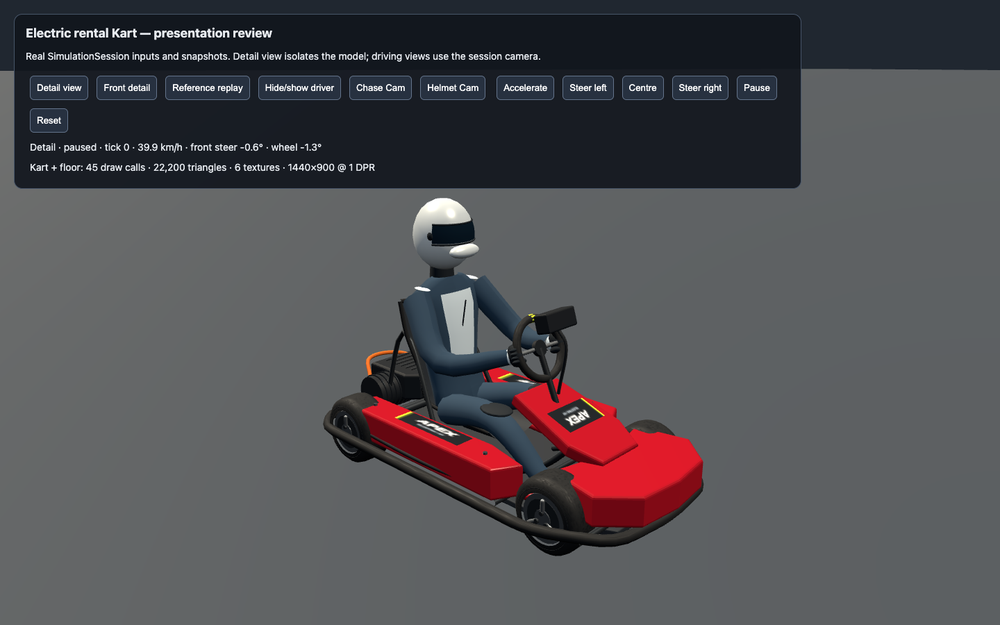
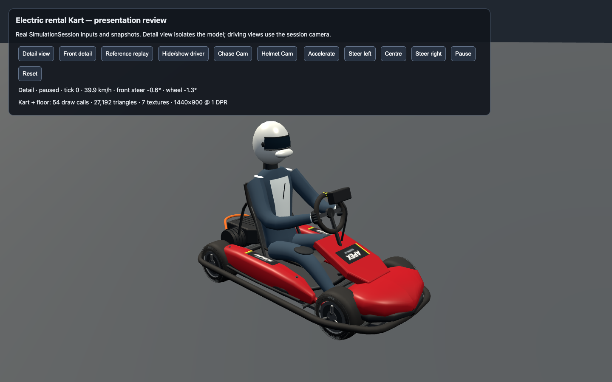
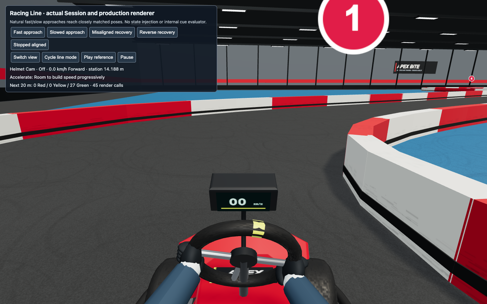
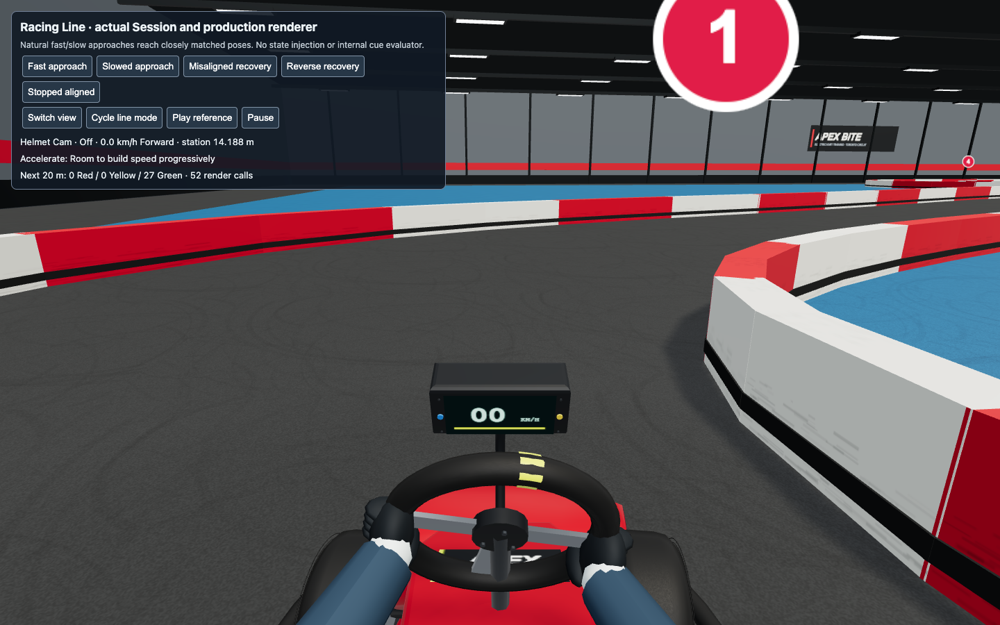
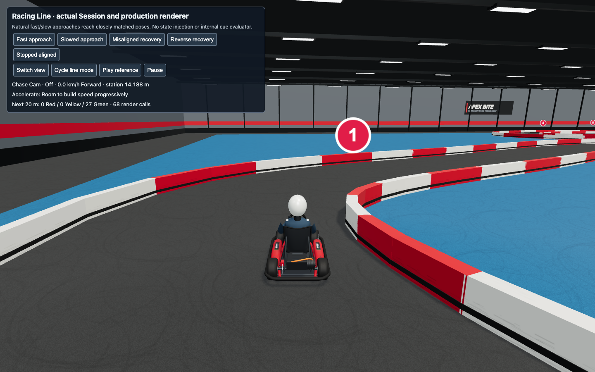

# Iteration 4: rental Kart refinement

Ticket #37 replaces the flat-sided nose and side-pod slabs with crowned moulded shells, separate black impact sections, and narrower inset labels. The tire material now uses subtle micrograin instead of visibly oversized square bumps; the sidewalls have raised rings and original subdued lettering. The wheel retains its physical diameter and grip locations, with flat machined spokes and hub fasteners. A shallower instrument housing has physical bezel screws and distinct mode buttons around the existing speed display.

This is a focused refinement of the existing authored Kart. The fitted iteration-3 driver is retained for #38. It is not a manufacturer scan or a completed acceptance claim for the whole Kart/driver presentation. The complete visual review checkpoint remains ahead of final integration.

## Asset inspection and provenance

Re-inspected the actual [Kenney Car Kit 3.1](https://kenney.nl/assets/car-kit) archive retained from iteration 3, including its `License.txt` and all five Kart GLBs. The included license explicitly grants CC0 personal, educational, and commercial use, with optional credit. The archive SHA-256 is `fac7dacac5c7874348cf19729af3ef205f3d366493edaf0a827d93f4fdf3d0c4`.

| Actual file | Bytes | Triangles | Materials | Skins / animations |
| --- | ---: | ---: | ---: | --- |
| kart-oobi.glb | 251,516 | 2,884 | 1 | 0 / 0 |
| kart-oodi.glb | 230,984 | 2,726 | 1 | 0 / 0 |
| kart-ooli.glb | 233,380 | 2,706 | 1 | 0 / 0 |
| kart-oopi.glb | 236,196 | 2,726 | 1 | 0 / 0 |
| kart-oozi.glb | 240,776 | 2,726 | 1 | 0 / 0 |

The broad, stylized forms and shared palette surface are unsuitable for the requested adult indoor-rental appearance. Their separated wheels are usable as simple rigid parts, but adopting their bodies would abandon the established proportions and require new bodywork/materials anyway; their unrigged characters do not solve the seated-driver requirement. The earlier detailed fit inspection is retained in [the iteration-3 driver report](iteration-3-driver.md). No Kenney mesh, texture, or other downloaded asset is included. The new shapes and Canvas textures are original project source, using the existing Three.js dependency and system Arial font; no new runtime dependency, download, or attribution obligation is introduced.

## Scale, animation, and shared appearance

The existing wheelbase, axle locations, tire radius, wheel width, steering-rim dimensions, hand grips, seating, eye position, camera field of view, collision parameters, and dynamics remain unchanged. New side-pod bodies reach 0.375 m from the centre, inside the existing bumper envelope; the nose stays inside the prior front-fairing extent. The sidewall detail sits on the existing tires. This slice changes rendering only.

The player and both Ghost Karts construct the same current rig, so the new mouldings, tires, steering detail, and binnacle appear on all of them. Ghost tint/transparency and suppression remain independent. Camera comfort controls and track sightlines are retained. The [public Kart states captured in matching scenes](iteration-4-kart/after-scene.json) match the [baseline states](iteration-4-kart/before-scene.json) exactly.

## Matching visual evidence

| View | Iteration-3 Kart | Updated Kart |
| --- | --- | --- |
| Front detail, same public Flying Start |  |  |
| Helmet Cam, stopped by public controls |  |  |
| Chase Cam, same stopped state |  |  |

The production-scene captures use the same public inputs, camera settings, viewport, and renderer. The old Kart source was temporarily restored only in this isolated worktree to capture the baseline and then restored to the update; simulation data was never injected. Floating Turn markers visible here are removed by the independent #39 slice.

Steering motion was exercised through public left/right inputs; retained [left](iteration-4-kart/after-scene-helmet-left.png) and [right](iteration-4-kart/after-scene-helmet-right.png) samples show the hands remain on the turning rim. A [separated Ghost Kart](iteration-4-kart/after-ghost-chase.png) uses the updated model. Driver anatomy, gloves, suit, and helmet refinement belong to the following driver slice.

## Cost and verification

The detail harness at 1440×900, DPR 1 reports 54 calls / 27,192 triangles / 7 textures including the floor, against 45 / 22,200 / 6 before. Helmet Cam culls geometry behind the eye: 39 calls / 19,988 triangles versus 32 / 16,872. The added texture is one original 256×256 RGBA sidewall sheet (256 KiB uncompressed before mipmaps); rubber micrograin grows from 128×128 to 256×256, adding 192 KiB per rig before mipmaps. No network texture files are added.

The production-scene sample uses Balanced quality, installed headless Chrome, 1440×900, DPR 1, and ANGLE Metal on Apple M5 Pro. After 60 warmup frames, 180 paused-scene frame intervals in each camera measure about 16.67 ms mean and 16.70 ms p95 both before and after. With a separated reference ghost actually visible, Chase Cam goes from 108 calls / 63,540 triangles to 126 / 73,524; Helmet Cam goes from 93 / 58,208 to 109 / 66,316. These short local samples meet the existing 60 FPS target on this hardware; they do not replace #43's moving four-lap production QA or establish performance on other hardware. Full raw [before](iteration-4-kart/before-scene.json) and [after](iteration-4-kart/after-scene.json) reports retain the browser version, frame distributions, GPU, and errors (none).

The physical-binnacle browser observation was red before adding its visible mode control (0 blue-control pixels) and green afterward. It observes the actual canvas, without inspecting mesh transforms or creating a private rendering interface. Run `tests/browser/kart-realism-check.mjs` against the existing presentation page; it accepts `APEX_BITE_PLAYWRIGHT_MODULE`, `APEX_BITE_KART_URL`, and `APEX_BITE_KART_EVIDENCE` overrides. The crop/color observation is specific to this deliberate art detail, not an automated judgement of overall realism.

Verification: 78 behavior tests, type checking, and production build pass. Existing rendered steering checks pass all six centre/left/right/return/reverse samples; current-model ghost checks pass four cases and overlap checks pass sixteen cases across both cameras. The existing Vite bundle advisory remains. The overall realism decision remains subject to the agreed complete-model user review.

After merging the integration branch through `1e88d85`, all **85 tests across 19 files**, type checking and the production build pass. The physical-control canvas check, two recorded ghost-steering comparisons, and sixteen overlap cases were rerun against this updated worktree and pass. The geometry/control experiments and replay schema are inherited from integration; this ticket does not change them. The compact detail reports retain the relevant Kart/camera state rather than duplicate the full Circuit four times per report.
