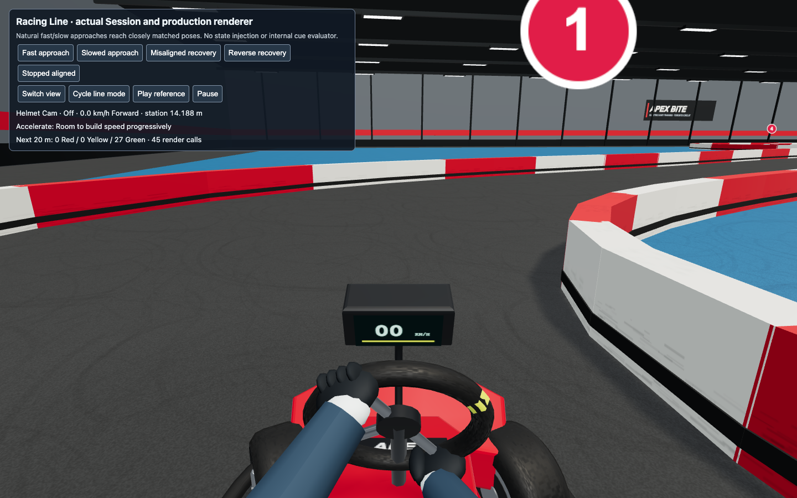
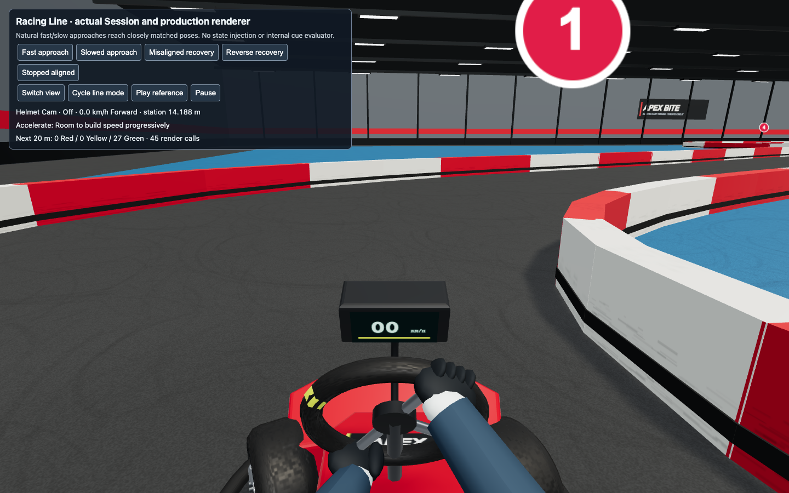
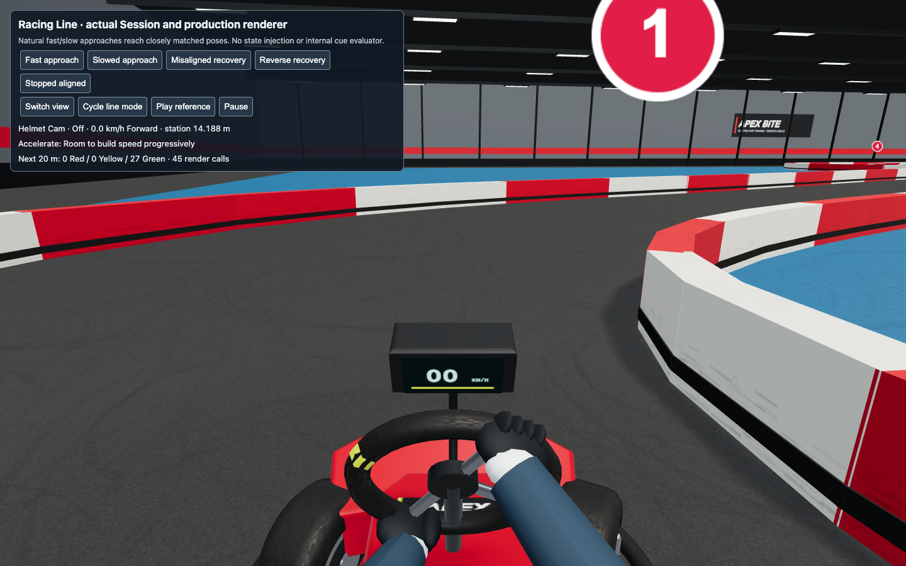

# Iteration 4: steering direction

Ticket #34 corrects the steering-wheel rendering sign. The Kart uses +X forward and +Z right: positive rotation about the rim's X axis moves its top toward the driver's right. Front-tire yaw uses a different axis convention. The rim had incorrectly copied its negative sign. Hands are attached to the rim and the sleeves follow their grips, so correcting the rim also corrects the hand/arm motion.

Only the rendering sign and an explanatory comment change in production. Kart physics, Keyboard Assistance, wheel steering angles, cameras, and replay positions are unchanged.

## Red → green evidence

The browser regression uses public Session controls in the existing Racing Line harness and captures the production renderer's canvas. It locates the visible yellow wheel-centre marker in a fixed Helmet Cam crop, rather than accessing scene objects or asserting transform values. The crop excludes the digital dash and nose decal. The broad colour tolerance checks movement direction, not exact pixel identity.

Before the fix, left input moved the marker from x=719.2 to x=862.7, failing the expected leftward movement. After the fix, left input moves it to x=570.7 and right input to x=862.7. Releasing steering returns it to x=719.2. Both reverse steering samples pass at the 8 km/h recovery limit. All six public Kart states match exactly between the before/after runs.

| Input | Before | After |
| --- | --- | --- |
| Left |  |  |
| Right |  |  |

The images show the hands remain on the rim at full left/right steering; the raised hand changes sides coherently with the input. Additional [Chase Cam evidence](iteration-4-steering-chase-right.png) and [reverse steering evidence](iteration-4-steering-helmet-reverse-right.png) retain the same corrected pose. The model's existing geometric appearance remains for the later realism tickets.

Machine-readable [before](iteration-4-steering-before.json) and [after](iteration-4-steering-after.json) evidence includes Chrome version, marker measurements, all six public Kart states, and browser errors (none).

## Reproduce

Start the existing Vite app on port 5184, then run `node tests/browser/steering-direction-check.mjs`. Set `APEX_BITE_PLAYWRIGHT_MODULE` to an installed Playwright entrypoint when it is not locally resolvable. `APEX_BITE_STEERING_URL` overrides the harness URL and `APEX_BITE_STEERING_EVIDENCE` selects the evidence output directory; the default is a temporary directory. No browser dependency is added to the game.

The test uses headless installed Chrome at 1440×900 and DPR 1. It checks six rendered centre/left/right/return/reverse states and retains both-camera screenshots. This is a directional visual regression for the existing yellow marker and camera framing; deliberate future art/framing changes should update the observation crop or marker treatment rather than add a private scene-graph seam.

## Verification

- Rendered steering regression: red on the original sign, green after correction (six samples).
- Manual image inspection: Helmet Cam left/right hand grip and direction, reverse-right pose, and Chase Cam coherence.
- Keyboard Assistance, camera comfort, reverse recovery, and training-record behavior suites: 24 tests pass.
- Type checking and production build pass. The existing bundle-size advisory remains unchanged.
